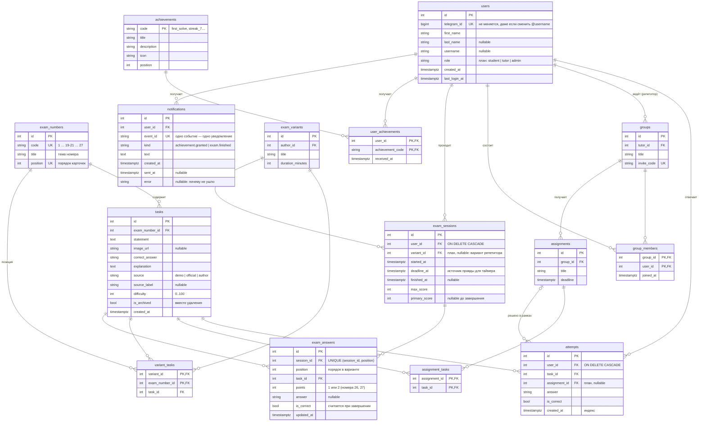

# ERD — модель данных

Статус ✅ — таблица **уже есть** в базе (создана миграциями Alembic).
«план» — запланирована на следующие этапы.

| Сущность | Таблица | Что это | Статус |
|---|---|---|---|
| Пользователь | `users` | Ученик (позже — репетитор, админ), вход через Telegram | ✅ |
| Номер ЕГЭ | `exam_numbers` | Позиция в экзамене: «1», …, «19-21», …, «27» | ✅ |
| Задача | `tasks` | Прототип номера: условие, ответ, разбор | ✅ |
| Попытка | `attempts` | Один ответ ученика на задачу | ✅ |
| Группа | `groups` | Учебная группа репетитора | план |
| Участник группы | `group_members` | Связь ученик ↔ группа | план (служебная) |
| Задание | `assignments` | Набор задач для группы с дедлайном | план |
| Задача задания | `assignment_tasks` | Связь задание ↔ задача | план (служебная) |
| Сессия пробника | `exam_sessions` | Прохождение пробника учеником: срок, баллы | ✅ |
| Ответ в пробнике | `exam_answers` | Позиция варианта: задача, баллы за неё, ответ ученика | ✅ |
| Вариант репетитора | `exam_variants` | Сохранённый вариант, собранный репетитором | план |
| Задача варианта | `variant_tasks` | Связь вариант ↔ задача | план (служебная) |
| Достижение | `achievements` | Справочник: «Первый шаг», «Неделя без пропусков»… | ✅ |
| Полученное достижение | `user_achievements` | Связь ученик ↔ достижение, дата | ✅ (служебная) |
| Уведомление | `notifications` | Сообщение ученику и статус отправки в Telegram | ✅ |

Итого 15 таблиц (9 уже в базе), из них **11 — объекты реального мира** (требование лабы: ≥ 10 таблиц, ≥ 7 реальных объектов).

## Схема

Картинка для презентации: [erd.png](erd.png).

## Решения, о которых могут спросить

- **Почему `telegram_id`, а не email/пароль.** Пароли не храним — нечему утечь. Telegram подтверждает личность сам.
- **Почему задачи не удаляются, а архивируются (`is_archived`).** На них ссылаются `attempts`: удаление сломало бы историю и статистику ученика.
- **Почему «решено» не хранится отдельной колонкой.** Это вычисляется из `attempts` (есть ли верная попытка). Нет дублирования — нет рассинхронизации.
- **Индекс `(user_id, task_id)` на `attempts`.** Все запросы статистики — «попытки этого ученика»; индекс делает их быстрыми при росте таблицы.
- **`ON DELETE CASCADE` для `attempts.user_id`.** Удаление аккаунта удаляет его попытки (персональные данные).
- **Что лежит в Redis, а не в PostgreSQL.** Временное и «быстрое»: ключи входа по QR и коды (TTL 5 минут), счётчик попыток ввода кода, указатель на идущий пробник (TTL = время до конца), блокировка от двойного старта, рейтинг (sorted set). Всё, что в Redis, можно восстановить из базы: срок пробника — `exam_sessions.deadline_at`, рейтинг — пересчётом из `attempts`.
- **Почему вариант пробника хранится как строки `exam_answers`, без отдельной таблицы вариантов.** Вариант собирается случайно для каждого ученика; позиция + задача + ответ — одна строка. Отдельная таблица `exam_variants` понадобится, когда репетитор начнёт собирать варианты вручную.
