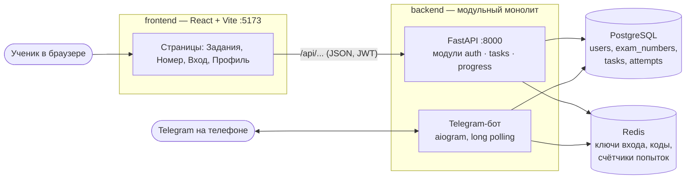
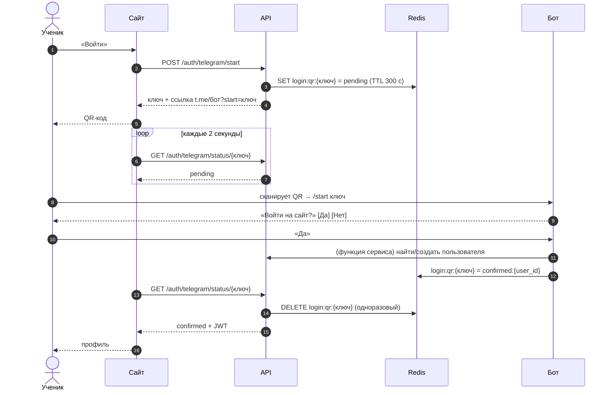
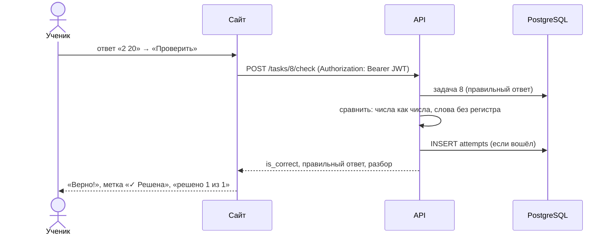

# Архитектура

## Компоненты

- **Модульный монолит.** Один backend, внутри — модули со своими таблицами и логикой:
  `auth` (пользователи, вход), `tasks` (номера и задачи), `progress` (попытки и статистика).
  Модуль `tasks` не знает, как считается «решено», — он получает от `progress` готовый подзапрос.
- **Слои внутри модуля:** `router` (HTTP, коды ответов) → `service` (логика) → `models` (таблицы).
  Схемы Pydantic в `schemas` — контракт API.
- **Бот** — отдельный процесс из того же кода: использует те же функции `auth.service`, что и API.
- **Запуск:** `docker compose up` поднимает `db`, `redis`, `api`, `bot`. `api` при старте применяет миграции и заполняет справочник номеров.

## Вход по QR-коду

## Проверка ответа и статистика

