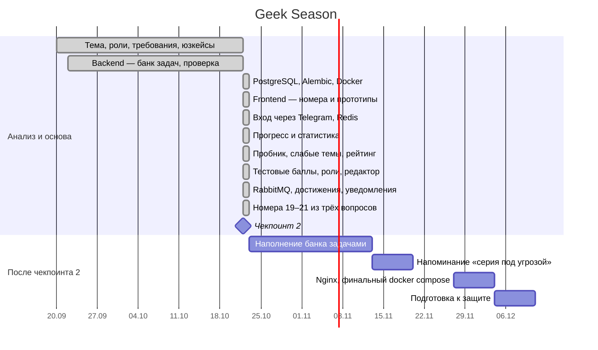

# Roadmap и график работ

> Обновлено 22.10.2026. Отв.: PM. **Я** — Яблуновский А.С., **К** — Кояков И.А.

## Сводка

Даты после чекпоинта 2 — план; дата защиты уточняется у преподавателя.

## Что сделано к чекпоинту 2

| Этап | Результат | Кто |
|---|---|---|
| Анализ | Требования, юзкейсы, ERD, контракты API — этот репозиторий | К, Я |
| Банк заданий | Номера 1–27, задачи, проверка ответа (числа, слова, несколько чисел), фильтры, сортировка, архив вместо удаления | Я |
| Данные | PostgreSQL, 4 миграции Alembic, 16 задач по 16 номерам | Я |
| Вход | Telegram-бот (aiogram), QR и код, одноразовые ключи в Redis, JWT, защита от перебора | Я, К |
| Прогресс | Таблица попыток, статистика: решено, точность, серия, график, по номерам | Я, К |
| Пробник | Вариант по номерам, серверный таймер, автосохранение, автозавершение, баллы, разбор | Я — API, К — экран |
| Мотивация | «Что повторить» в профиле, рейтинг за неделю и всё время (Redis) | Я, К |
| Сайт | Страницы «Задания», «Номер», «Вход», «Профиль», «Пробник», «Результат», «Рейтинг»; адаптив под телефон | К |
| Инфраструктура | `docker compose up`: db, redis, api, bot | Я |
| Брокер | RabbitMQ, воркер, достижения, уведомления в Telegram; повторы, «мёртвые письма» | Я |
| Качество | 104 автотеста (pytest), включая негативные сценарии | Я |

### Отклонения от плана — честно

- **Чекпоинт 1 пропущен.** Его материалы (требования, юзкейсы, ERD, API, roadmap) сдаются вместе со вторым.
- **Команда — 2 человека** вместо 3–5, поэтому объём сокращён: сначала роль ученика, репетитор — следующим этапом.
- **Стек:** Python/FastAPI вместо ASP.NET Core — FastAPI даёт тот же Swagger из кода; Redis добавлен для временных данных с TTL.
- **Дизайн:** собран прямо в коде на единых переменных цвета (тёмная тема); макеты в Figma — догоняем.

## План до защиты

| # | Этап | Что войдёт | Кто | Готово, когда… |
|---|---|---|---|---|
| 2 | Наполнение | ≥ 5 задач на каждый номер | К, Я | На каждой карточке ≥ 5 задач |
| 6 | Уведомления | Бот пишет о новом задании и дедлайне | Я | Уведомление приходит один раз, без дублей |
| 7 | Выкладка | Nginx перед frontend и API, единый compose | Я | Всё открывается на одном адресе |
| 8 | Защита | Презентация, демо-сценарий, ответы на вопросы | К — ведёт, Я — демо | Прогон без ошибок |
