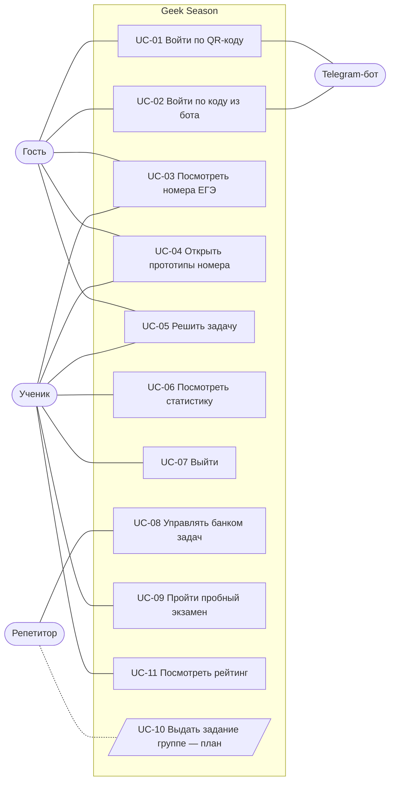

# Варианты использования

> Версия 1.0 от 22.10.2026 · Связанный документ: [Бизнес-требования](business-requirements.md)

## Диаграмма

## Сводка

| ID | Сценарий | Актор | Требования | Статус |
|---|---|---|---|---|
| UC-01 | Войти по QR-коду | Гость, бот | BR-01, 03, 04, 05 | ✅ |
| UC-02 | Войти по коду из бота | Гость, бот | BR-02, 03, 04 | ✅ |
| UC-03 | Посмотреть номера ЕГЭ | Гость, ученик | BR-06, 16 | ✅ |
| UC-04 | Открыть прототипы номера | Гость, ученик | BR-07, 08, 17, 18 | ✅ |
| UC-05 | Решить задачу | Гость, ученик | BR-12, 13, 14, 15 | ✅ |
| UC-06 | Посмотреть статистику | Ученик | BR-19 | ✅ |
| UC-07 | Выйти | Ученик | BR-05 | ✅ |
| UC-08 | Управлять банком задач | Администратор | BR-09, 10, 11 | ✅ |
| UC-09 | Пройти пробный экзамен | Ученик | BR-25 – 27 | ✅ |
| UC-11 | Посмотреть рейтинг | Гость, ученик | BR-28 | ✅ |
| UC-10 | Выдать задание группе | Репетитор | BR-21 – 23 | ⏳ |

---

## UC-01. Войти по QR-коду

**Акторы:** гость, Telegram-бот
**Основной поток:**
1. Гость нажимает «Войти». Сайт запрашивает у сервера одноразовый ключ (Redis, 5 минут).
2. Сайт показывает QR-код со ссылкой `t.me/<бот>?start=<ключ>` и обратный отсчёт.
3. Гость сканирует QR телефоном → открывается бот: «Войти на сайт Geek Season?» [Да] [Нет].
4. Гость нажимает «Да». Бот находит или создаёт пользователя по `telegram_id` и помечает ключ подтверждённым.
5. Сайт, опрашивающий сервер каждые 2 секунды, получает JWT и открывает профиль.

**Исключения:**
- 3a. Ключ устарел (прошло 5 минут) → бот: «Ссылка устарела»; сайт показывает «QR-код устарел» и кнопку «Показать новый код».
- 4a. Нажато «Нет» → сайт: «Вход отменён в боте», можно получить новый QR.
- 4b. Ссылку открыл второй человек (переслали) → подтверждение не перезаписывается, бот: «Ссылка устарела».
- 5a. По подтверждённому ключу второй браузер не войдёт: ключ удаляется при первой выдаче токена.
- Подставной QR (злоумышленник показывает свой QR жертве) → бот не входит молча, а предупреждает: «Нажимайте "Да", только если вы сами открыли страницу входа».

**Постусловие:** ученик вошёл; токен хранится в браузере.

---

## UC-02. Войти по коду из бота

**Акторы:** гость, Telegram-бот
**Основной поток:**
1. Гость отправляет боту `/login`.
2. Бот выдаёт код из 6 цифр (живёт 5 минут).
3. Гость вводит код на странице входа → сайт получает JWT и открывает профиль.

**Исключения:**
- 3a. Неверный или устаревший код → «Неверный или устаревший код» (400).
- 3b. Код уже использован → 400: код одноразовый.
- 3c. Больше 5 попыток в минуту с одного адреса → «Слишком много попыток. Подождите минуту» (429) — защита от перебора миллиона вариантов.
- 2a. Повторный `/login` → новый код, старый перестаёт действовать.
- 3d. Код не из 6 цифр → кнопка «Войти» неактивна; API отвечает 422.

---

## UC-03. Посмотреть номера ЕГЭ

**Актор:** гость или ученик
**Основной поток:**
1. Пользователь открывает «Задания».
2. Сайт показывает 25 карточек (1…18, 19–21, 22…27): номер, тема, число задач.
3. Для вошедшего ученика на карточке полоска прогресса и «решено X / Y».
4. Поиск по номеру или теме фильтрует карточки на лету.

**Исключения:** сервер недоступен → «Не удалось загрузить номера»; поиск без совпадений → «Ничего не найдено».

---

## UC-04. Открыть прототипы номера

**Актор:** гость или ученик
**Основной поток:**
1. Пользователь нажимает карточку номера.
2. Сайт показывает задачи номера: условие, источник, сложность; ответов и разборов в данных нет.
3. Доступны фильтр по источнику (демо / экзамен / авторская) и сортировка; по 20 задач, кнопка «Показать ещё».
4. Для вошедшего ученика — метки «✓ Решена» / «✗ Не решена», «решено X из Y» и фильтр «Все / Нерешённые / Решённые».
5. Стрелки ведут к соседним номерам.

**Исключения:**
- Несуществующий номер → «Номер ЕГЭ не найден» (404).
- В номере нет задач / ничего не подошло под фильтр → понятное сообщение; при «Нерешённые» и пустом результате — «Все задачи решены».
- Фильтр по прогрессу без входа → 401 (на сайте гость этого фильтра не видит).

---

## UC-05. Решить задачу

**Актор:** гость или ученик
**Основной поток:**
1. Пользователь вводит ответ и нажимает «Проверить».
2. Сервер сравнивает ответ с правильным. Верно — возвращает правильный ответ и разбор. Неверно — только «неверно» и сколько ещё ошибок до разбора: ученик пробует снова.
3. Если пользователь вошёл, ответ сохраняется в его статистику; метка задачи и счётчик «решено» обновляются сразу.
4. После трёх неверных ответов появляется кнопка «Показать ответ и разбор». Ученик может открыть их и затем решить задачу — она засчитывается как обычно.

**Исключения:**
- Пустой ответ → кнопка неактивна; API — 422.
- Ответ длиннее 100 символов или лишние поля в запросе (например, `is_correct`) → 422: клиент не может «назначить» себе верный ответ.
- Задача не существует или в архиве → 404.
- Гость → проверка работает, но ответ не сохраняется; сайт подсказывает «Войдите, чтобы ответы сохранялись».
- Токен устарел → проверка работает как у гостя, без ошибки.
- Повторный верный ответ на уже решённую задачу → попытка сохраняется, но «решено» не увеличивается.
- Запрос разбора раньше трёх ошибок (в обход сайта) → 403 «Разбор откроется после ещё N неверных ответов».
- У задачи 19–21 неверные части — без ответа и разбора; верные — с разбором.

---

## UC-06. Посмотреть статистику

**Актор:** ученик
**Основной поток:**
1. Ученик открывает профиль.
2. Сайт показывает: решено задач (из всех в банке), точность, серию дней, всего ответов.
3. График «Ответы за 14 дней»; при наведении или нажатии на столбик — число ответов и верных за день.
4. Прогресс по номерам с переходом к задачам номера; последние 10 ответов.

**Исключения:**
- Ответов ещё нет → «Вы ещё не решали задачи» и кнопка «Решать задания».
- Не вошёл → переход на страницу входа; API — 401.
- Задача ушла в архив → она не считается в «решено», но попытка остаётся в истории.
- Ответ в 00:30 по Москве засчитывается в новый день (статистика считает дни по Europe/Moscow).

---

## UC-07. Выйти

**Основной поток:** ученик нажимает «Выйти» в профиле → токен удаляется из браузера, шапка снова показывает «Войти».

---

## UC-08. Управлять банком задач

**Актор:** администратор («Админка» → вкладка «Задачи»; ученик её не видит)
**Основной поток:**
1. Создать задачу: номер, условие, правильный ответ, разбор, источник, сложность → 201 и `id`.
2. Изменить только нужные поля (PATCH).
3. Убрать задачу (DELETE) → задача уходит в архив (204) и пропадает из списков.

**Исключения:** гость → 401, ученик → 403 «Только для администратора»; несуществующий номер → 422; пустое условие или `null` в обязательном поле → 422; сложность вне 0–100 → 422; задача не найдена → 404.

---

## UC-12. Управлять учениками

**Актор:** администратор («Админка» → вкладка «Ученики»)
**Основной поток:**
1. Найти ученика по имени, нику, @username или Telegram ID; открыть карточку.
2. Изменить нужное: PTS числом или ранг из списка; сбросить калибровку (следующий пробник снова входной);
   ник, аватарку, дату регистрации; роль; блокировку; сбросить всю статистику.
3. Опасные действия подтверждаются в карточке («Точно? Да / Отмена»).
4. Действие появляется в карточке ученика и во вкладке «Журнал».

**Исключения:** свою роль поменять и себя заблокировать нельзя → 422; админа сначала нужно понизить, потом
блокировать → 422; плохой ник → 422 с причиной; дата в будущем → 422; калибровки нет → 422.
Заблокированный ученик при любом запросе получает 403 и попадает на страницу входа с сообщением; бот не выдаёт ему вход.

---

## UC-09. Пройти пробный экзамен

**Актор:** ученик
**Основной поток:**
1. Ученик открывает «Пробник» и читает правила, нажимает «Начать пробник».
2. Сервер собирает вариант (по случайной задаче на каждый номер), фиксирует начало и срок окончания (235 минут).
3. Ученик видит таймер, навигацию по номерам и задачи без ответов.
4. Ответы сохраняются сами через 0,7 с после ввода («✓ сохранено»).
5. Ученик нажимает «Завершить пробник» → подтверждает (сайт напоминает, сколько задач без ответа).
6. Сервер проверяет ответы, считает первичный балл (26 и 27 — по 2), записывает ответы в статистику, начисляет очки рейтинга.
7. Ученик видит результат: баллы, верные ответы и разбор каждой задачи.

**Исключения:**
- 1a. Пробник уже идёт → «Начать» и сама страница возвращают его же; новый не создаётся.
- 1b. Двойное нажатие «Начать» → второй запрос получает 409, создаётся только один пробник.
- 3a. Перезагрузка страницы / закрытие вкладки → тот же пробник, сохранённые ответы, реальное оставшееся время.
- 4a. Время вышло → сервер не принимает ответ: 409 «Время вышло»; пробник завершается сам с ответами, данными вовремя.
- 4b. Сайт сам завершает пробник, когда отсчёт дошёл до нуля.
- 5a. Повторное «Завершить» → тот же результат без пересчёта.
- Ответы и разборы не отдаются API до завершения ни в одном запросе.
- Чужой пробник → 404 (не раскрываем, что он существует).
- В банке нет задач → 409 «В банке нет задач для пробника».

---

## UC-11. Посмотреть рейтинг

**Основной поток:** пользователь открывает «Рейтинг» → видит топ-20 за неделю или за всё время;
вошедший ученик выделен, а если он не в топе — видит своё место под таблицей.
**Правила:** 1 очко за задачу, решённую впервые; повтор очков не даёт; равные очки — общее место.
**Исключения:** нет очков → «У вас пока нет очков за этот период»; гость → «Войдите, чтобы попасть в рейтинг»;
Redis очищен → рейтинг пересобирается из базы, цифры не теряются.

## UC-10. Выдать задание группе (план)

Репетитор выбирает группу, задачи и дедлайн → каждый ученик получает задание и уведомление в Telegram →
репетитор видит статус по каждому: не начато / в процессе / сдано / просрочено.
